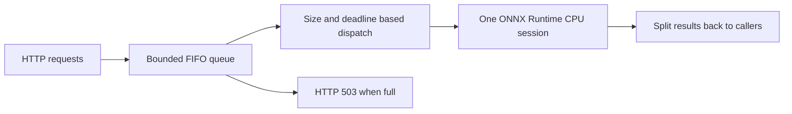

# BatchServe ONNX

A CPU inference service that combines independent HTTP requests into batches for ONNX Runtime. It limits pending work, propagates request deadlines to the scheduler, and exports Prometheus metrics for request outcomes, queue wait, batch sizes, and model runtime.

[](https://github.com/Vcode2407/batchserve-onnx/actions/workflows/ci.yml)

## Measured behavior

On a local 32-client workload, dynamic batching served all 1,024 predictions per trial with a median of **450 model calls**, down from 1,024 single-item calls. Median throughput was 116.60 versus 101.20 predictions per second. At one client, the batch wait increased median latency from 5.29 ms to 16.17 ms. The benchmark uses CPU inference and a seeded synthetic network. [Measurements, workload, and overload drill](docs/benchmark.md)

## Run locally

Use Python 3.12.

```sh
python -m pip install -r requirements-dev.txt
python -m uvicorn batchserve.api:app --host 127.0.0.1 --port 8080
```

From another terminal, send a prediction and check the metrics endpoint.

```sh
python -m scripts.smoke
```

Run the container locally with Docker.

```sh
docker build -t batchserve-onnx .
docker run --rm -p 127.0.0.1:8080:8080 batchserve-onnx
```

## Prediction contract

`POST /v1/predict` takes 128 little-endian float32 inputs (512 bytes) and returns 32 float32 values (128 bytes). Use `Content-Type: application/octet-stream`. Input components must be finite and in [-1000, 1000]. Set `X-Timeout-Ms` to an integer from 1 to 5,000 for the server's deadline. The default is 1,000 ms.

| Status | Meaning |
| --- | --- |
| 200 | Prediction ready before the deadline |
| 400 / 413 / 415 | Invalid input, oversized input, or unsupported content type |
| 502 | Runtime invocation failed |
| 503 | Queue at capacity or scheduler unavailable |
| 504 | Deadline elapsed while receiving, waiting, or executing |

`/healthz` reports process liveness. `/readyz` checks that the warmed model's scheduler is accepting work. `/metrics` exposes the current process counters and histograms.

## Scheduling and failure handling



- The oldest queued request starts the assembly window. The worker dispatches when the batch fills, the window elapses, or a candidate approaches its deadline. It uses a small configurable guard before that deadline. FIFO order determines which requests are considered.
- The queue limit applies to requests waiting for dispatch. At most one additional batch is in flight. Expired or cancelled queued tasks release their slots. An in-flight deadline ends that request's wait, while the shared invocation completes for the rest of the batch.
- The worker runs ONNX off the event loop. A failed model call reports an error to that batch and the worker accepts later work. On shutdown it drains admitted work and stops accepting new requests.
- The demo uses one API process and one fixed-shape synthetic model. The model is generated from a reproducible seed at startup.

| Environment variable | Default |
| --- | ---: |
| `BS_BATCH_SIZE` | 16 |
| `BS_QUEUE_CAPACITY` | 128 |
| `BS_MAX_WAIT_MS` | 2 |
| `BS_DEADLINE_GUARD_MS` | 2 |
| `BS_INTRA_OP_THREADS` | 1 |

## Verification

```sh
python -m pytest -q
python -m scripts.benchmark
```

Tests cover numerical parity with NumPy and single-item inference, batch ordering, deadline expiry before and after dispatch, queue overflow, cancellation, recovery after model errors, and shutdown.

[ONNX Runtime Python API](https://onnxruntime.ai/docs/api/python/api_summary.html) · [Triton dynamic batching](https://docs.nvidia.com/deeplearning/triton-inference-server/user-guide/docs/user_guide/batcher.html)
